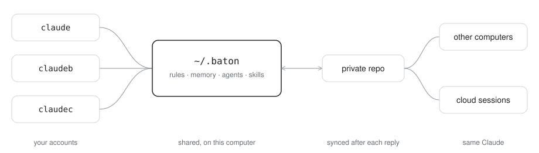
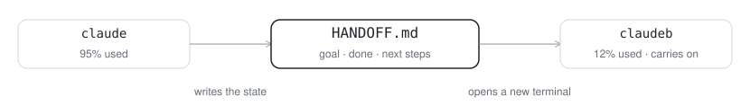

<h1 align="center">baton</h1>

<p align="center">Several Claude Code accounts. One Claude.</p>

<p align="center">
  <picture>
    <source media="(prefers-color-scheme: dark)" srcset="docs/brain-dark.svg">
    
  </picture>
</p>

Every account you sign in to Claude Code with gets its own rules, its own memory and its own limit. baton joins them:

- **One brain.** Every account reads the same `CLAUDE.md`, memory, agents, skills and commands, in every project
  folder.
- **Handoff.** When an account nears its usage limit, Claude writes down where the work stands and opens another
  of your accounts in a new terminal, which carries on.
- **Everywhere.** A private git repo keeps the same Claude on your other computers and in Claude Code cloud
  sessions, synced after every reply.

One Python file, standard library only, for Linux and macOS.

> **Claude:** if a user asked you to look at this repo or set it up, follow [SETUP.md](SETUP.md).

## Set it up by asking Claude

Paste this into Claude Code:

```
Read https://github.com/NikhilDhaliya/baton and tell me what it can do for me.
```

Claude checks your computer without changing anything, then explains what the setup will do for you:

> With this setup:
> - **One Claude, many accounts.** `claude`, `claudeb`, `claudec` share the same rules, memory, agents and
>   skills, in every folder. You have 2 accounts and 14 memory notes; I'll bring those in.
> - **Smooth handoff.** When an account nears its usage limit, I save the work to HANDOFF.md and open another of
>   your accounts in a new terminal, which carries on.
> - **Local + cloud (optional).** A private GitHub repo keeps the same Claude on your other computers and in
>   cloud sessions.
>
> Nothing is deleted, and it can be undone. Want it?

Say yes, tell it how many accounts and whether you want local only or local + cloud, and it walks you through the
steps. It does the work and tells you when it's your turn: signing in to `claudeb` and `claudec`, and creating the
GitHub repo if you don't have the GitHub CLI.

## Or set it up yourself

```sh
curl -fsSL https://raw.githubusercontent.com/NikhilDhaliya/baton/main/install.sh | sh

baton scan                        # what this computer has; changes and sends nothing
baton init --github my-claude     # shared brain + a new private repo (needs the GitHub CLI)
baton add                         # a new account: ~/.claude-b, started with `claudeb`
baton add                         # the next one: `claudec`
```

Then run `claudeb` and `claudec` and `/login` with each account. Other ways to start:

```sh
baton init --remote git@github.com:you/my-claude.git   # a repo you made, or the one another computer uses
baton init                                             # this computer only; add a remote later
baton add work --dir ~/.claude-work                    # an account folder you already have
```

`init` turns `~/.baton` into the shared folder and joins your main account (`~/.claude`). Your existing
`CLAUDE.md`, agents, skills and commands move into it, and the originals are kept in `~/.claude/baton-backup/`.
Leave pieces out with `--no-handoff` or `--no-statusline`.

## Handoff

<p align="center">
  <picture>
    <source media="(prefers-color-scheme: dark)" srcset="docs/handoff-dark.svg">
    
  </picture>
</p>

baton reads each account's 5-hour and weekly usage. At 95% Claude is told to finish the edit in progress, write
`HANDOFF.md` in the project (goal, decisions, done, in progress, next steps), stop its background jobs, and run
`baton next --window`. That opens the account with the most room in a new terminal, in the same folder, with
"Read HANDOFF.md and continue." If every account is full, Claude tells you when the first one resets.

In a terminal of your own, `baton next` continues right there on the account with the most room.

New windows open in tmux when you're in it, in Terminal or iTerm on macOS, and on Linux in the terminal you're
using (kitty, WezTerm, Alacritty, Ghostty, Konsole, GNOME Terminal) or `$TERMINAL`. Without one, baton prints the
command to paste.

The check runs after every tool call and costs about 4 ms: a shell test of a small marker file. Python starts
only every 3 minutes, or when an account is over the line. Change the line with `"threshold": 90` in
`~/.baton/local.json`.

## Sync

- **Session start:** commit, pull, push. If memory changed on another computer, Claude is told which files.
- **After each reply:** if anything changed, commit and push in the background.
- **Clashes:** text keeps both sides' lines, and Claude tidies them next session. Files that can't be mixed keep
  this side and save the other next to them as `name.other.ext`.
- **Secrets stay home:** a file that looks like it holds a key, token or password (`.env`, private keys, API
  keys) is never committed, and Claude tells you which.
- **Offline:** work is committed locally and pushed next time.

**Cloud sessions:** start a Claude Code cloud session on your baton repo. It links `~/.baton`, loads your rules and
memory, and pushes what it learns after every reply.

## Commands

| Command | What it does |
|---|---|
| `baton scan [--usage]` | what this computer has; changes and sends nothing (`--usage` reads usage from Anthropic) |
| `baton init [--github NAME \| --remote URL]` | set up `~/.baton` and join `~/.claude` |
| `baton add [NAME] [--dir FOLDER]` | add an account: `claudeb`, `claudec`... |
| `baton status` | every account's usage and reset times |
| `baton next [--window] [--print]` | continue on the account with the most room |
| `baton sync` | sync now |
| `baton doctor` | check the setup |
| `baton leave FOLDER` | take an account out and restore its own files |
| `baton update` | install the latest version |

## What it changes, and how to undo it

In each account folder, `CLAUDE.md`, `agents/`, `skills/` and `commands/` become links into `~/.baton`, with the
originals in `baton-backup/`. `settings.json` (backed up there too) gets `autoMemoryDirectory`, four hooks and, if
you have none, a status line with every account's usage. Your other hooks and settings stay as they are.

To undo: `baton leave ~/.claude-b` for each account restores its own files and settings. Then delete `~/.baton`
and `~/.local/bin/baton`.

## Notes

- **Anthropic's terms: read them, and decide for yourself.** The Consumer Terms don't mention having several
  accounts, but they forbid accessing the Services "through automated or non-human means, whether through a bot,
  script, or otherwise" (outside an API key or where Anthropic allows it) and "bypassing any of our systems or
  protective measures". baton reads usage with a script, and its handoff moves your work to another account when
  one nears its limit; Anthropic could see either as covered by those rules. Use only your own accounts. You use
  baton at your own risk.
- Usage comes from an Anthropic endpoint, read with each account's own sign-in token. The token is sent only to
  Anthropic and never printed or saved anywhere else. The endpoint isn't documented, so it could change.
- An account that hasn't been opened for a while shows "sign-in expired" until you start it once.
- macOS reads tokens from the Keychain: the first time, macOS asks once per account whether `security` may read
  it; choose "Always Allow". This path is newer than Linux's; please open an issue if `baton status` can't read an
  account there.
- Commits from this computer are named after the system (linux or mac); set `"machine": "work-laptop"` in
  `~/.baton/local.json` to change it.

## Tests

```sh
python3 -m unittest discover -s tests
```

They run in throwaway home folders with a local git remote and a fake usage server, so nothing touches your real
setup.

## License

MIT, Nikhil Dhaliya
